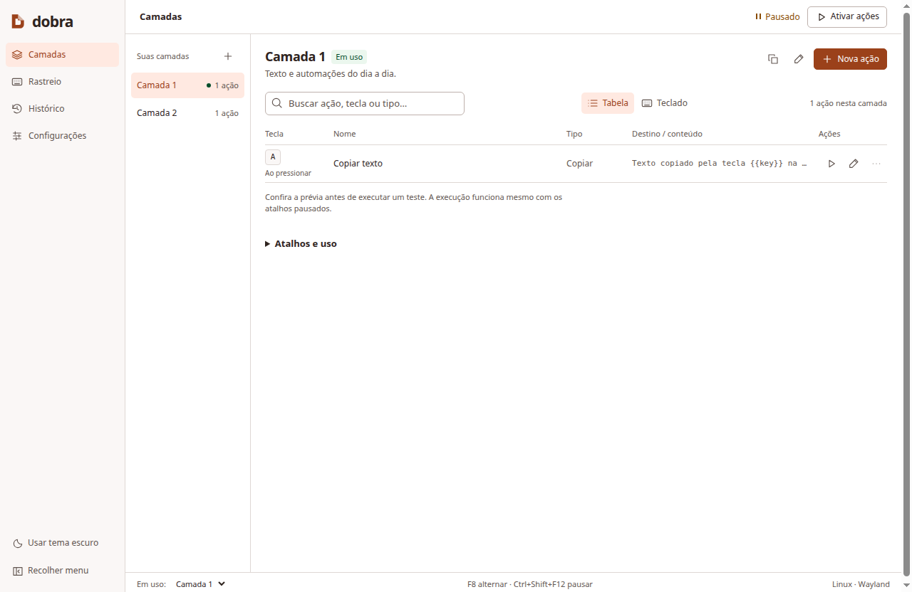
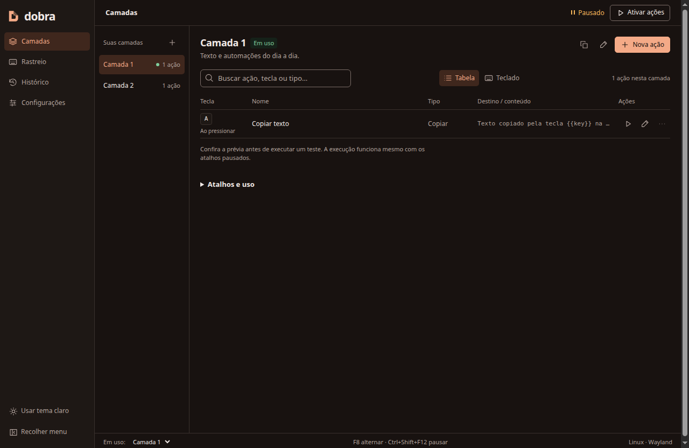

<picture>
  <source media="(prefers-color-scheme: dark)" srcset="app/assets/dobra-logo-dark.svg">
  
</picture>

# Dobra

**Mais possibilidades em cada tecla.**

[](https://github.com/raulaguila/key-tracker/actions/workflows/desktop.yml)
[](https://github.com/raulaguila/key-tracker/actions/workflows/platform-audit.yml)
[](https://github.com/raulaguila/key-tracker/actions/workflows/security.yml)
[](LICENSE)

Dobra é um aplicativo desktop de automação por teclado para Windows, macOS e
Linux. Organize ações em camadas: a mesma tecla pode copiar um texto numa camada,
criar um arquivo em outra ou executar uma sequência de tarefas. A interface está
em português e oferece temas claro, escuro e automático.

**Status: em desenvolvimento.** Há builds de teste no GitHub Actions; ainda não
há uma release pública assinada. Assinatura, notarização e validação em hardware
real fazem parte do [processo de distribuição](docs/PRODUCTION.md).



<details>
  <summary>Ver tema escuro</summary>



</details>

## O que você pode fazer

- Organizar atalhos em camadas e alternar entre elas por tecla ou pelo aplicativo.
- Copiar texto, abrir URLs/arquivos/aplicativos, mostrar notificações, enviar
  requisições HTTP e criar ou acrescentar conteúdo em arquivos.
- Executar sequências com até dez etapas e configurar o delay entre elas.
- Disparar ações ao pressionar, enquanto mantém a tecla ou ao soltá-la, com
  delay inicial e intervalo de repetição separados.
- Conferir teclas pressionadas num teclado visual, com layouts e formatos ajustáveis.
- Acompanhar resultados, cancelar execuções e exportar o histórico da sessão.
- Associar camadas a aplicativos, usar a bandeja e importar/exportar configurações.

## Instalar ou experimentar

Enquanto a release pública não estiver disponível, abra
[Actions → Desktop](https://github.com/raulaguila/key-tracker/actions/workflows/desktop.yml),
escolha uma execução bem-sucedida da `main` e baixe o artifact do seu sistema.
É necessário estar conectado ao GitHub para baixar artifacts. Eles são builds de
desenvolvimento e não são atualizações automáticas.

| Destino do CI | Pacote | Artifact |
| --- | --- | --- |
| Windows x64 | Instalador `.exe` | `dobra-Windows-X64` |
| macOS Apple Silicon | `.dmg` ou `.zip` ARM64 | `dobra-macOS-ARM64` |
| macOS Intel | `.dmg` ou `.zip` x64 | `dobra-macOS-X64` |
| Linux x64 | `.AppImage` ou `.deb` | `dobra-Linux-X64` |

[Instalação, permissões e limitações por sistema](docs/INSTALLATION.md).

Para executar pelo código-fonte, instale Node.js 24 e npm:

```bash
git clone https://github.com/raulaguila/key-tracker.git
cd key-tracker
npm ci
npm start
```

O repositório mantém o endereço `raulaguila/key-tracker`; o aplicativo e o pacote
se chamam Dobra. Dependências nativas e acesso a uma sessão gráfica são necessários.
Veja o [guia de desenvolvimento](docs/DEVELOPMENT.md).

## Primeiro uso

1. Abra **Camadas** e crie uma ação. Por padrão, a camada 1 associa `A` a copiar
   texto; a camada 2 usa `A` para criar uma nota em `Documentos/Dobra`.
2. Confira a ação em **Testar**. A prévia não executa; **Executar teste** realiza
   uma execução real, mesmo com os atalhos pausados.
3. Clique em **Ativar ações**. `F8` alterna camadas; `Ctrl+Shift+F12` pausa/retoma
   (`⌘+Shift+F12` no macOS). Configure outras combinações em **Configurações**.
4. Ative **Rastreio** separadamente para visualizar o teclado.

As ações começam pausadas e o rastreio, desligado. Atalhos globais podem interferir
na digitação em outros programas: escolha combinações adequadas ao seu uso.
Pausar impede novos disparos; **Parar todas** também cancela execuções em andamento.

## Compatibilidade

| Ambiente | Atalhos ao pressionar | Manter/soltar e rastreio global |
| --- | --- | --- |
| Windows x64 | Integração nativa, sujeita a conflitos | Dependem da sessão e permissões |
| macOS ARM64/x64 | Integração nativa, sujeita a conflitos | Exigem as permissões de entrada do sistema |
| Linux x64/X11 | Integração nativa | Exigem bibliotecas X11 disponíveis |
| Linux/Wayland | Dependem do portal e compositor | Indisponíveis; rastreio local com a janela em foco |

Os quatro destinos têm CI nativo. Isso não substitui testar instalação,
permissões e teclados físicos no ambiente de uso. ARM64 para Linux/Windows não
faz parte da matriz atual.

## Dados e privacidade

O Dobra não grava as teclas rastreadas, não reconstrói texto digitado e não envia
telemetria. Ações HTTP acessam os destinos configurados; abrir uma URL a encaminha
ao navegador/sistema. Configurações com headers HTTP usam o cofre seguro do sistema;
configurações sem headers podem ficar em JSON legível. A exportação portátil
remove todos os headers HTTP, inclusive nas sequências.

[Política de privacidade](docs/PRIVACY.md) · [Segurança](SECURITY.md)

## Documentação e contribuição

| Quero… | Documento |
| --- | --- |
| Instalar e resolver problemas de permissões | [Instalação](docs/INSTALLATION.md) |
| Configurar camadas, ações e rastreio | [Guia de uso](docs/USAGE.md) |
| Entender pressionar, manter e soltar | [Momentos da tecla](docs/KEY_MOMENTS.md) |
| Executar testes ou gerar pacotes | [Desenvolvimento](docs/DEVELOPMENT.md) |
| Preparar uma distribuição assinada | [Produção e release](docs/PRODUCTION.md) |
| Contribuir ou relatar um problema | [Contribuição](CONTRIBUTING.md) |
| Consultar arquitetura, contrato e evidências | [Índice completo](docs/README.md) |

Consulte as [mudanças ainda não lançadas](CHANGELOG.md). Relatórios antigos e
protótipos estão identificados como históricos; não substituem os guias atuais.

## Licença

[MIT](LICENSE). As dependências mantêm suas próprias licenças.
