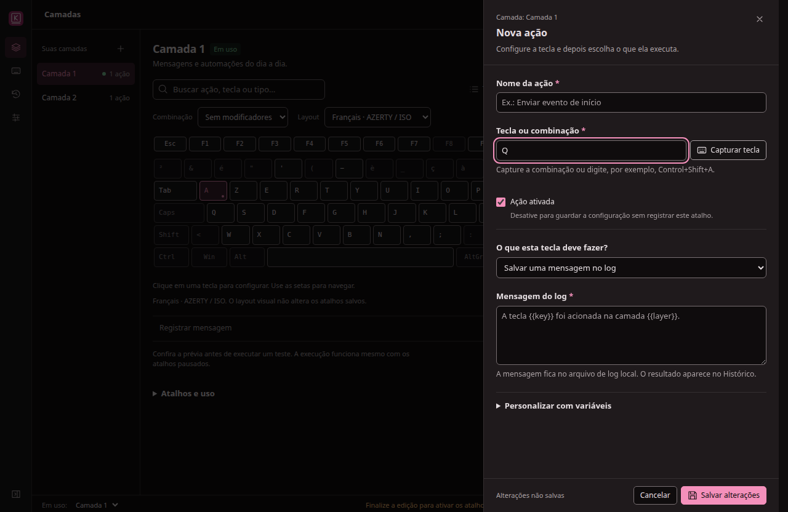
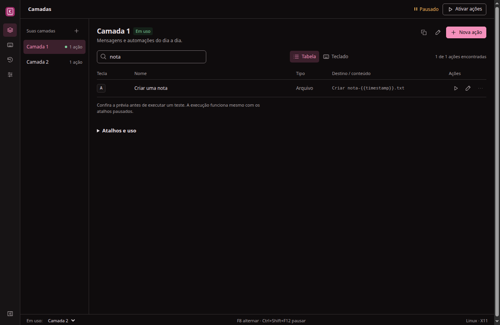

# Auditoria do sistema — UI/UX e performance

Data: 20/10/2026. Versão auditada: `0d861122c9a72bfc5a40c3417e4867bc7dae5220`.
Esta entrega documenta a análise; não modifica o comportamento do aplicativo.

## Avaliação visual

**Aprovada quanto a padrões visuais.** A interface tem identidade consistente,
hierarquia compacta, ações contextuais e controles previsíveis. Não foram
encontrados gradientes decorativos, painéis aninhados ou cartões de métricas sem
função que justifiquem outro redesenho. O maior ganho agora está na consistência
dos estados e na confiabilidade das operações.

## Resultado executivo

**9 achados: 0 P0, 3 P1, 6 P2 e 0 P3.** Recomenda-se corrigir os três P1 antes de
uma release pública: um arquivo aceito no salvamento pode impedir a próxima
abertura; a captura de atalhos diverge do editor visual em AZERTY; e uma troca
externa de camada pode deixar título e ações em contextos diferentes.

A experiência comum respondeu bem no equipamento de laboratório: inicialização
mediana de **292 ms**, busca com p95 de **1,1 ms** e baixo uso de CPU em repouso.
Com 2.500 ações, há custo mensurável no transporte e processamento do estado:
edição via IPC com p95 de **16,5 ms** e salvamento com p95 de **52,3 ms**. O consumo
de memória merece atenção para máquinas modestas, mesmo com o frontend pequeno.

| Dimensão técnica de UI | Nota | Evidência e limite |
| --- | ---: | --- |
| Acessibilidade | 3/4 | 16 verificações axe sem violações detectadas; foco nos drawers e rótulos; sem leitor de tela real nem validação nativa a 200% |
| Performance | 3/4 | Boa resposta comum; reconstrução de listas e cópias completas do estado custam mais em configurações grandes |
| Responsividade | 3/4 | Cobertura de layouts e janela compacta; teclado com rolagem própria; alvos de toque incompletos |
| Temas | 4/4 | Tokens e estados coerentes nas telas inspecionadas nos temas claro e escuro |
| Hierarquia e padrões visuais | 4/4 | Interface intencional, compacta e consistente, sem ruído decorativo relevante |
| **Total** | **17/20 — bom** | Avaliação heurística da UI, não certificação WCAG nem aprovação funcional da release |

As notas visuais não compensam os P1 de funcionamento. P1 significa impacto
importante em um fluxo reproduzido; P2 tem condição mais restrita ou alternativa
operacional. Nenhum P0 generalizado foi identificado no escopo verificado.

## Escopo e método

- Revisão do renderer, contrato IPC, motor, persistência, execução de ações,
  captura, monitor de aplicativos, bandeja e fechamento.
- Inspeção no Electron real em Linux/X11 isolado, perfis descartáveis e dados de
  teste. Quatro telas, temas claro/escuro, tabela, teclado interativo e drawers.
- Verificação visual em 1280 e 800 px, exploração em 390 px e emulação de ponteiro
  de toque. A largura de 390 px é teste de CSS, não suporte a um aplicativo móvel.
- Layout francês real no Xvfb, com evento XTest nativo, para distinguir
  `KeyboardEvent.key` de `KeyboardEvent.code`. O layout do display de teste foi
  restaurado e os processos próprios foram encerrados.
- Benchmark do executável Linux empacotado, correspondente aos arquivos de
  produção desta revisão; cinco inicializações com perfis novos e três tamanhos
  de configuração. CDP apenas nos processos de teste, em loopback.
- Reprodução dos casos do motor em fronteiras controladas. Os achados de
  concorrência e falha da bandeja não foram reproduzidos com disco lento ou
  desaparecimento real do host da bandeja: essa diferença está indicada abaixo.

`npm run check`, **54 testes unitários** e `xvfb-run -a npm run test:ui` passaram.
O smoke cobre 112 combinações de tela/tema/sidebar e 90 combinações de
layout/formato/largura/tema do teclado, além dos fluxos de edição e execução.
A primeira execução sem permissão de loopback falhou no arquivo de testes HTTP;
a suíte completa passou no ambiente que permite o servidor local de teste.
Os testes atuais não cobrem os novos cenários descritos nesta auditoria.

O CI da revisão base também concluiu testes e empacotamento em Linux, Windows e
macOS. Isso não equivale a uma auditoria visual ou medição nativa desses dois
últimos sistemas nesta entrega.

## Achados prioritários

### F01 · P1 — Salvamento aceito pode impedir a próxima abertura

**Categoria:** confiabilidade e UX de recuperação.
**Locais:** [config.cjs:85](../../../app/config.cjs#L85),
[storage.cjs:16](../../../app/storage.cjs#L16),
[storage.cjs:31](../../../app/storage.cjs#L31),
[main.cjs:137](../../../app/main.cjs#L137).

A validação aplica o limite de 256 KiB ao JSON compacto; a gravação usa JSON
indentado. A próxima leitura e a importação comparam o tamanho real do arquivo.
Uma configuração aceita pode, portanto, ser recusada na abertura seguinte.

**Reprodução:** a fixture medida com 25 camadas e 100 ações por camada passou em
`validateConfig`: 254.920 bytes compactos. `Storage.save` produz **548.895 bytes**.
`Storage.load` rejeita esse arquivo por exceder 262.144 bytes. Uma fixture menor,
com 25 × 51 ações, também reproduziu: 138.662 bytes compactos e 289.312 gravados.
O arquivo é preservado; não foi observada corrupção ou exclusão dos dados.
Exportar e importar novamente sofre da mesma divergência de critérios.

**Impacto:** o usuário recebe sucesso ao salvar e perde acesso normal à
configuração depois de reabrir, exigindo recuperação manual do arquivo.
**Recomendação:** compartilhar a regra e a serialização entre validar, gravar,
carregar, importar e exportar. Recusar excedentes antes de substituir o arquivo
válido. Testar o ciclo salvar → reiniciar e exportar → importar perto do limite.
**Confiança:** alta, reproduzido na persistência real. Sem classificação WCAG.

### F02 · P1 — Captura e editor visual discordam em layouts internacionais

**Categoria:** UX de entrada e internacionalização.
**Locais:** [app.js:953](../../../app/renderer/app.js#L953),
[keyboard-bindings.mjs:9](../../../app/renderer/keyboard-bindings.mjs#L9).

A captura deriva letras de `event.code`, que identifica posição física; o editor
visual usa a legenda lógica do layout. No layout francês, o mesmo acionamento
gera `key: 'a'`, `code: 'KeyQ'`, `isTrusted: true`; a captura preenche **Q**,
enquanto clicar na tecla **A** do editor visual configura **A**.

**Impacto:** atalhos diferentes conforme a forma de cadastro, apesar de o usuário
escolher a mesma tecla. A divergência foi provada em AZERTY; não se deve afirmar
que todos os layouts internacionais foram testados nativamente.
**Recomendação:** unificar a resolução lógica dos aceleradores nos dois editores;
reservar códigos físicos à representação do Rastreio. Tratar símbolos e teclas
especiais explicitamente, preservando a sintaxe aceita pelo Electron. Testar
eventos nativos em FR, DE e BR, com modificadores.
**Confiança:** alta. [Prova nativa](native-capture-proof.json).
Comando de UI sugerido: `$impeccable harden`. Sem classificação WCAG.



### F03 · P1 — Troca de camada durante a busca mistura contextos na tela

**Categoria:** UX e consistência de estado.
**Locais:** [app.js:1065](../../../app/renderer/app.js#L1065),
[app.js:1068](../../../app/renderer/app.js#L1068),
[app.js:403](../../../app/renderer/app.js#L403).

**Reprodução:** abrir Camada 1, focar a busca e trocar a camada externamente por
`api.setLayer(layer2)`, caminho usado pelo controle nativo. Digitar “nota”.
O seletor inferior passa à Camada 2, título/sidebar continuam na Camada 1 e a
tabela passa a listar “Criar uma nota”, da Camada 2. Tirar o foco não resolve.
O código altera `selectedLayerId`, mas impede o render completo durante foco
textual; o próximo `updateBindings` usa a nova seleção com o cabeçalho antigo.

**Impacto:** o usuário pode editar ou cadastrar uma ação acreditando estar em
outra camada. O F8 fica suspenso durante foco textual; a reprodução não depende
dele, e sim da mudança externa de estado.
**Recomendação:** preservar a camada visualizada durante a busca ou atualizar
seleção, cabeçalho, tabela e contexto do formulário de modo atômico. Se adiar a
atualização, aplicá-la explicitamente ao sair do campo. Testar troca por bandeja
e API com busca focada e verificar também o destino de “Nova ação”.
**Confiança:** alta, interface real. Comando: `$impeccable harden`.
Sem classificação WCAG atribuída.



## Demais achados

### F04 · P2 — Intervalo entre ações também bloqueia o atalho de pausa

**Categoria:** confiabilidade do controle global.
**Local:** [engine.cjs:184](../../../app/engine.cjs#L184).
O cooldown é consultado antes do ramo `isPause`. Com intervalo de 10.000 ms,
retomar pelo atalho e pressioná-lo imediatamente para pausar mantém o motor
ativado até terminar o intervalo. O botão da UI continua disponível.
**Recomendação:** separar o controle de pausa do intervalo configurado para ações,
mantendo apenas uma proteção curta contra repetição da tecla. Testar retomada
seguida de pausa com o maior intervalo permitido.
**Confiança:** alta, reprodução controlada do motor. Sem classificação WCAG.

### F05 · P2 — Duas gravações podem desfazer uma alteração anterior

**Categoria:** concorrência e feedback de salvamento.
**Locais:** [app.js:455](../../../app/renderer/app.js#L455),
[main.cjs:33](../../../app/main.cjs#L33).
Cada alteração envia uma cópia completa da configuração. A fila do processo
principal serializa gravações, mas não detecta que a segunda cópia ficou antiga.
Com dois snapshots da mesma revisão, desativar A e depois B resulta em
`[true, false]`, embora ambas as chamadas tenham retornado sucesso; o esperado
era `[false, false]`.
**Reprodução:** ordem de I/O controlada na fronteira do motor/fila, permitindo
criar as duas cópias antes de concluir a primeira gravação. Não houve medição da
frequência do problema em cliques humanos ou em disco lento real.
**Recomendação:** impedir mutações concorrentes na UI ou usar operações específicas
e revisão esperada no IPC; sinalizar conflito sem substituir silenciosamente
mudanças. Testar duas alterações rápidas em ações distintas com atraso de I/O.
**Confiança:** alta no contrato de snapshots; exposição temporal da UI depende de
latência. Comando de UI: `$impeccable harden`. Sem classificação WCAG.

### F06 · P2 — Criar camada sem associação reaplica contexto automático

**Categoria:** previsibilidade da seleção de camada.
**Local:** [engine.cjs:132](../../../app/engine.cjs#L132).
`contextRules` inclui IDs e ordem de todas as camadas, mesmo sem aplicativos.
Com um aplicativo associado à Camada 2, escolher manualmente a Camada 1 e salvar
uma nova camada com `applications: []` reaplica a Camada 2 sem mudança de
aplicativo. A escolha manual deveria continuar válida nesse cenário.
**Recomendação:** comparar regras efetivas de associação e o opt-in; preservar
override manual em alterações que não mudam essas regras. Cobrir criação,
duplicação e reordenação sem associações, mantendo a prioridade quando regras
reais forem alteradas.
**Confiança:** alta, reprodução do motor. Sem classificação WCAG.

### F07 · P2 — Bandeja indisponível durante confirmação ainda permite ocultar

**Categoria:** recuperação e ciclo de vida da janela.
**Local:** [window-lifecycle.cjs:22](../../../app/window-lifecycle.cjs#L22).
A decisão `toTray` é congelada antes da confirmação. Se `shouldHide()` retorna
`true` na solicitação e `false` antes de confirmar, `confirm()` ainda oculta a
janela. O tratamento de indisponibilidade pode mostrá-la durante o diálogo, mas
a confirmação posterior volta a escondê-la.
**Impacto:** aplicativo ativo sem ícone de recuperação; uma segunda abertura pode
recuperar a janela, portanto não foi classificado como bloqueio absoluto.
**Recomendação:** revalidar a disponibilidade ao confirmar; se perdida, manter a
janela visível e explicar o ocorrido, preservando a intenção de apenas ocultar.
**Confiança:** alta na reprodução controlada do ciclo de vida; não foi removido
um host real de bandeja durante um diálogo. Sem classificação WCAG.

### F08 · P2 — Estado completo e listas recriadas elevam custo com muitos itens

**Categoria:** performance.
**Locais:** [engine.cjs:37](../../../app/engine.cjs#L37),
[app.js:1056](../../../app/renderer/app.js#L1056),
[app.js:411](../../../app/renderer/app.js#L411).
`publish()` clona o estado duas vezes; notificações e respostas IPC transportam
snapshots. O renderer serializa configurações para compará-las e recria linhas
e seus menus ocultos a cada atualização da lista. Com 100 ações visíveis, foram
contados 4.028 elementos DOM; com duas ações, 182. São elementos, não a contagem
total de nós DOM usada no ensaio de retenção.

Com as mesmas 100 ações visíveis, aumentar a configuração total de 100 para
2.500 ações elevou a mediana do IPC de edição de **1,4 para 13,1 ms** e a do
salvamento de **2,8 para 32,3 ms**. É evidência de escala, sem atribuir todo o
tempo a uma função específica ou ao disco: validação, I/O, transporte e resposta
da UI participam do custo.
**Recomendação:** revisão de configuração em vez de `JSON.stringify` por evento,
menos cópias/publicações integrais, respostas pequenas para mutações, atualização
das linhas afetadas e criação de menus sob demanda. Repetir o benchmark antes e
depois. O limite atual de 100 ações por camada não justifica por si só trocar de
framework ou adicionar virtualização complexa.
**Confiança:** alta para as medidas e caminhos identificados; contribuição exata
de cada etapa requer perfil de CPU. Comando: `$impeccable optimize`.
Sem classificação WCAG.

### F09 · P2 — Adaptação para toque não cobre teclado interativo e seletor

**Categoria:** responsividade e facilidade de operação.
**Locais:** [styles.css:466](../../../app/renderer/styles.css#L466),
[styles.css:479](../../../app/renderer/styles.css#L479).
Com `pointer: coarse` em viewport de 800 px, “Nova ação” mede 44 px de altura,
mas uma tecla comum mede **34,9 × 32 px**, F1 **40,9 × 24 px** e o seletor de
camada **82 × 23 px**. As regras de toque omitem esses controles.
**Recomendação:** ampliar as áreas interativas para cerca de 44 × 44 CSS px em
ponteiros grossos e preservar a geometria ISO/ABNT2. O teclado de Rastreio, apenas
informativo, pode continuar compacto.
**Padrão:** 44 px é recomendação de usabilidade e referência AAA; essas medidas
isoladas não provam violação AA, cujos critérios e exceções são diferentes.
**Confiança:** alta, [medidas DOM](coarse-targets-confirmed.json) com emulação de
ponteiro, sem teste em tela física de toque. Comando: `$impeccable adapt`.

## Performance medida

### Ambiente e interpretação

Intel i9-12900K, 24 CPUs lógicas, 61,6 GiB de RAM, Linux 7.0.0-38-generic,
Node 24.15.0, Electron 44.9.1, Xvfb e GPU desabilitada. Máquina compartilhada,
instrumentação CDP e caches do SO não isolados. Perfil novo não equivale a
inicialização fria de todo o sistema. Resultados não são um SLO para outros PCs.

[Dados completos da rodada principal](performance.json). O frontend próprio soma
aproximadamente 139 KB de HTML/CSS/JS sem compressão, sem framework. O custo de
distribuição vem sobretudo do runtime: diretório Linux cerca de 296 MiB,
AppImage 123 MiB e DEB 97 MiB, valores arredondados dos artefatos locais.

| Operação / amostras | 2 ações / 2 camadas | 100 ações / 1 camada | 2.500 ações / 25 camadas |
| --- | ---: | ---: | ---: |
| Busca, p95, n=20 | 1,1 ms | 8,8 ms | 8,9 ms |
| Navegação entre telas, p95, n=48 | 8,9 ms | 19,2 ms | 16,2 ms |
| Abrir drawer, p95, n=12 | 14,0 ms | 27,4 ms | 27,9 ms |
| Alternar estado de edição via IPC, p95, n=40 | 3,7 ms | 3,8 ms | 16,5 ms |
| Salvar configuração via IPC, p95, n=5 | 1,3 ms | 5,1 ms | 52,3 ms |

Busca, navegação e abertura medem a duração síncrona dos handlers/DOM, não pintura
final, INP ou tempo percebido completo. IPC mede ida e volta da chamada real.
Com cinco amostras, p95 é o máximo observado; não é uma estimativa robusta de
cauda. As diferenças pequenas entre navegação com 100 e 2.500 ações não sustentam
que a configuração maior seja mais rápida.

Inicialização, da criação do processo até o controle inicial disponível, teve
mediana **292,3 ms** e máximo **300,4 ms** em cinco perfis novos. O caminho de
atualização de tecla do processo principal ao callback DOM teve mediana
**0,344 ms**, p95 **0,616 ms** e máximo **1,451 ms** em 240 eventos sintéticos por
IPC, com captura global habilitada. Isso **não mede a latência de um teclado
físico**, nem USB, hook completo, compositor ou apresentação na tela.

Uma [rodada independente de validação do script](performance-validation.json)
teve inicialização mediana de 284,3 ms; com 2.500 ações, p95 de 15,2 ms na edição
e 40,2 ms no salvamento. O p95 de IPC de teclas foi 2,34 ms. Essa variação entre
rodadas reforça que números submilissegundo não devem ser tratados como garantia
de resposta de hardware. A tabela principal conserva uma rodada completa, sem
selecionar o melhor valor de cada execução.

### CPU e memória

| Estado, sequência na mesma sessão | CPU média reportada | Soma RSS média | Snapshot soma PSS |
| --- | ---: | ---: | ---: |
| Padrão pausado, 8 s | 0,047% | 521,9 MiB | 220,5 MiB |
| Rastreio global ligado sem digitação, 8 s | 0,021% | 703,7 MiB | 308,6 MiB |
| Monitor de aplicativo ligado, 8 s | 0,057% | 608,8 MiB | 301,7 MiB |
| Configuração grande após interações, 5 s | 0,042% | 968,9 MiB | 650,8 MiB |

CPU é a soma dos percentuais retornados pelo Electron entre chamadas de
`getAppMetrics`, descartando a primeira leitura. RSS soma páginas compartilhadas
mais de uma vez. PSS reparte páginas compartilhadas entre processos e é mais
útil para interpretar a participação de memória. Ambas abrangem os processos
listados pelo Electron e são snapshots, não toda a árvore de processos do SO.
Não se deve comparar a soma RSS diretamente com memória física exclusiva.

As etapas são sequenciais, com navegação, alocações e possível retenção do
runtime. O cenário grande foi medido antes da coleta forçada; não representa uma
configuração grande recém-aberta nem prova vazamento de memória. O monitor
consultou o backend X11, mas o display sem gerenciador de janelas não forneceu
aplicativo em foco; não medimos o custo de transições reais entre aplicativos.
Diferenças pequenas de CPU próximas de zero estão dentro da variabilidade desse
ensaio curto. O consumo base de memória ainda merece meta própria em PC modesto.

Após **240 navegações e 60 aberturas/fechamentos de drawer** adicionais, com
coleta forçada antes/depois, documentos (2), nós (5.491) e listeners (651)
permaneceram iguais. Heap JS usado passou de 2.557.396 para 2.687.352 bytes,
aproximadamente +127 KiB. Não houve tarefa longa acima de 50 ms registrada pelo
observador nesta rodada. O ensaio curto não exclui vazamentos em uso prolongado.

Referências metodológicas: [CPU no Electron](https://www.electronjs.org/docs/latest/api/structures/cpu-usage),
[métricas por processo](https://www.electronjs.org/docs/latest/api/structures/process-metric)
e [PSS/RSS no Linux](https://www.kernel.org/doc/html/latest/filesystems/proc.html).

### Reproduzir o benchmark

Com dependências instaladas e pacote Linux atualizado da revisão a medir:

```bash
npm run pack
xvfb-run -a node scripts/performance-audit.cjs artifacts/audit/performance.json
```

Requer Linux, Xvfb, acesso de depuração em loopback e Node com WebSocket global.
O script usa perfis temporários, não reutiliza configuração do usuário e remove
os próprios dados ao terminar. Não comparar revisões com executável empacotado
desatualizado. Uma nova rodada gera novos números; conservar ambiente e amostras.

## O que preservar e o que ainda falta validar

**Pontos positivos:** sidebar recolhível, hierarquia enxuta, tema escuro consistente,
indicadores acompanhados de texto, drawers sobrepostos com foco contido, proteção
de rascunhos, prévia antes de executar, busca contextual, fallback explícito de
captura, isolamento do hook e consulta de aplicativo fora do renderer. Limites de
concorrência, histórico, arquivos e timeout reduzem trabalho sem controle.

As 16 verificações axe resultaram em **zero violações detectadas**.
[Resultados completos](axe-screens.json). Há itens `incomplete` de contraste
de glifos e sobreposição detectada pelo motor; foram inspecionados visualmente,
sem defeito confirmado. Duas releituras de Configurações com o cursor afastado
eliminaram a interferência do tooltip. Isso não substitui avaliação com leitor
de tela, contraste de todos os estados e ampliação real.

Padrões recorrentes: snapshots integrais dificultam tanto concorrência quanto
performance; atualizações parciais sem uma política única misturam contexto;
decisões sobre estado externo precisam ser revalidadas quando confirmadas.
Priorizar essas fronteiras dá mais retorno do que reduzir novamente toda a UI.

Faltam: uso prolongado com muitas execuções, medição com teclado físico, PC de
menor capacidade, toque físico, ampliação nativa de 200%, leitor de tela e QA
visual/nativo em Windows/macOS/Wayland. Ctrl+Plus/ControlEqual não ampliou a
interface testada e o menu atual não oferece zoom; não foi contabilizado como
teste de ampliação. A auditoria não é um pentest nem teste de carga de URLs
externas. Nenhuma execução real foi direcionada a serviços de terceiros.

## Ordem recomendada de trabalho

1. **P1:** corrigir o contrato de tamanho/persistência (F01) e acrescentar teste
   de reinício e reimportação com configuração próxima do limite.
2. **P1 · `$impeccable harden`:** unificar captura lógica (F02) e tornar a troca de
   contexto atômica (F03), com reprodução nativa e busca focada nas regressões.
3. **P2:** separar a pausa do cooldown (F04), garantir consistência de mutações
   (F05), preservar override manual (F06) e revalidar a bandeja (F07).
4. **P2 · `$impeccable optimize`:** reduzir clones, serializações e menus/linhas
   recriados (F08); repetir as medidas sem adicionar infraestrutura desnecessária.
5. **P2 · `$impeccable adapt`:** completar os alvos de toque interativos (F09),
   preservando teclados ISO/ABNT2 e a densidade atual no mouse.
6. **`$impeccable polish`:** revisão final dos estados e alinhamentos após as
   correções, seguida de nova auditoria para comparar resultado e regressões.

As etapas podem ser executadas individualmente ou em conjunto; a persistência
e os demais P1 devem vir antes de otimizações ou acabamento visual.
