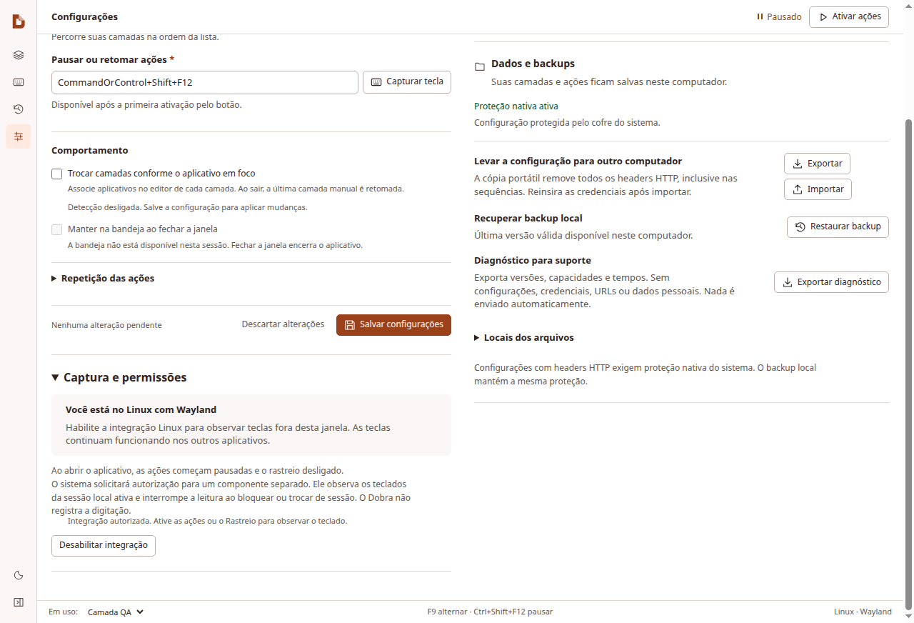
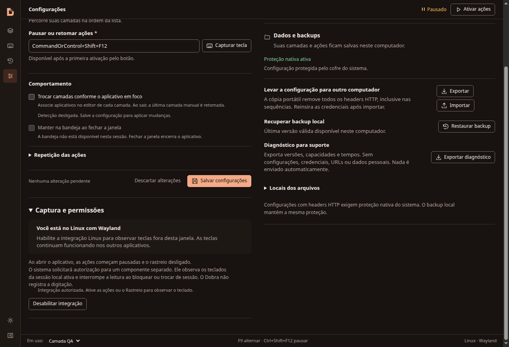

# Integração Wayland — 21/10/2026

Implementação baseada em `42d5cbd`, antes do commit desta entrega.
[Resultados estruturados](results.json) · [Guia de instalação](../../WAYLAND.md)

## Entrega

Serviço evdev de leitura passiva, Polkit e D-Bus autenticado. Electron e ações
continuam sem privilégios. Não há grab, injeção, texto digitado, logs de teclas
ou transmissão de eventos pela rede. Habilitação e reativação são explícitas.

O UID e PID reais são verificados no logind, inclusive o Display gráfico para
processos iniciados por systemd --user. Sessões locais ativas e desbloqueadas
recebem um stream privado, com filtros e fila limitados. Lock, suspensão, troca
de sessão, cliente perdido, heartbeat expirado ou fila cheia encerram a leitura.

Rastreio reutiliza o stream e os snapshots de teclas mantidas. Ressincronização,
hotplug e alteração de seat cancelam gestos sem sintetizar ações. A drenagem da
fila interna do libevdev continua sem depender de outro evento físico. Eventos
retidos mais de 1 s no transporte encerram a integração antes de executar ações.

O `.deb` inclui serviço ativado por D-Bus, políticas e dependências; não habilita
nem inicia o serviço no boot. AppImage requer esse componente instalado.

## Validação local

- Sintaxe e 200 testes Node: passaram.
- 21 testes Python: GIO/D-Bus reais em barramento privado, autoridade e teclados
  simulados; incluem cliente de produção, FD privado, negação, isolamento entre
  clientes, vínculo PID/sessão, lock durante autorização, heartbeat, backpressure,
  múltiplos teclados, SYN_DROPPED, drenagem e mudança de seat.
  O serviço limita o tamanho serializado antes de materializar argumentos D-Bus.
- Electron: fluxo de permissão simulado somente no processo de teste, nova
  tentativa, mensagens legíveis, temas, Rastreio e pausa na perda da sessão.
- Axe: 14 estados, zero violações WCAG A/AA. 112 combinações responsivas e
  90 combinações de geometria do teclado.
- O primeiro CI detectou overflow de 4 px a 390 px em Configurações. O botão
  de permissão passa a quebrar linha dentro da largura disponível; prova adicional
  usa um contêiner de 180 px para cobrir diferenças de fontes entre ambientes.
- Hook X11 real em Xvfb: outro processo recebeu texto, modificadores e solturas
  enquanto as ações foram executadas; sem registro exclusivo.
- Ciclo de vida: encerramento e drenagem passaram. Auditoria de runtime: completa,
  32 fontes correspondentes no ASAR e três encerramentos graciosos.
- Build Linux: `.deb` e AppImage gerados. Inspeção do `.deb`: seis payloads
  `root:root` 0644, dependências, ativação sob demanda e remoção do serviço.

## Limite da evidência

O ambiente não disponibiliza `/dev/input` ou `/dev/uinput`. O serviço não foi
instalado nem autorizado no computador do usuário. A suíte privada não comprova
entrega em hardware físico, agente Polkit de um desktop instalado, tela de
bloqueio, suspensão, troca de usuário/VT ou atualização/desinstalação real.
Esses cenários precisam ser executados separadamente em GNOME e KDE antes de
anunciar compatibilidade certificada. O CI complementa a regressão de Linux,
Windows, macOS ARM e Intel; não substitui essa prova instalada.

## Interface

