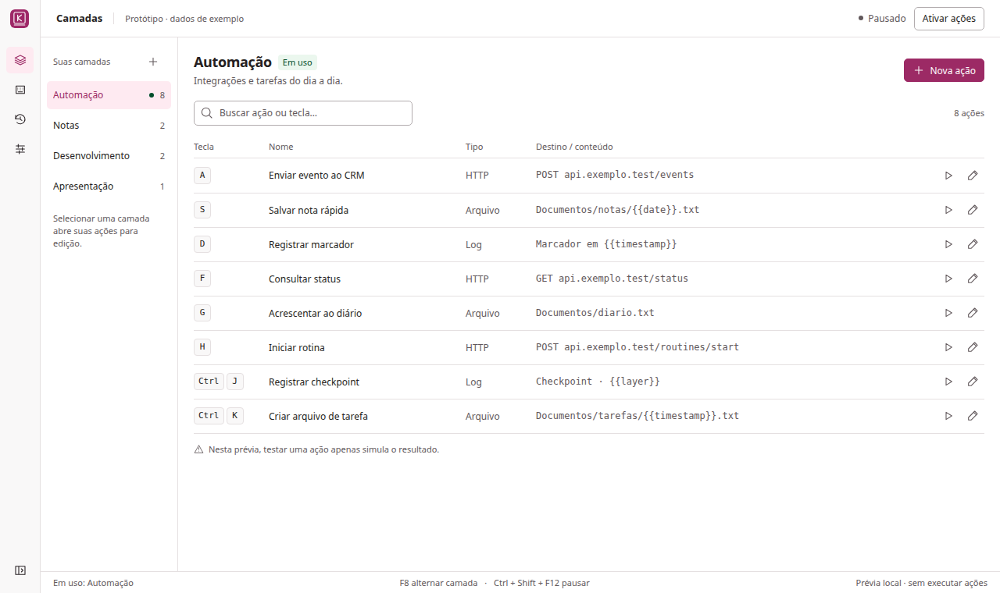
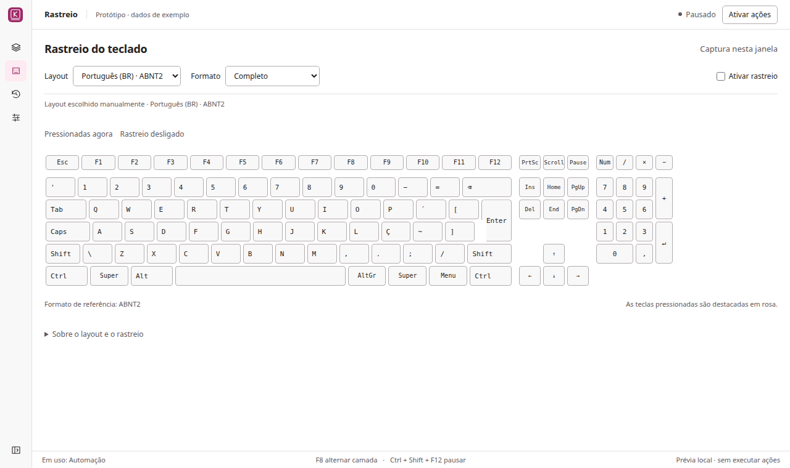

# Proposta de interface compacta

Protótipo navegável anterior à aplicação do novo design no aplicativo.
Tema claro e rosa do produto preservados; foco em densidade, alinhamento e
controle por mouse/teclado. A implementação atual do Electron não foi alterada.

## Experimentar

Abra `index.html` em um navegador. Para testar a detecção do layout em um contexto
local seguro, execute na raiz do repositório:

```bash
python3 -m http.server 8765 --bind 127.0.0.1
```

Acesse `http://127.0.0.1:8765/docs/prototypes/compact/`.

Não requer instalação ou bibliotecas externas. Os dados são exemplos em memória;
recarregar restaura a prévia. Requests, criação de arquivos, atalhos globais,
importação/exportação e configurações são simulados e identificados como tal.

## Direção visual

| Elemento | Aplicativo atual | Proposta |
| --- | --- | --- |
| Barra superior | Mínimo de 80 px | 48 px |
| Menu recolhido | 72 px | 52 px |
| Título principal | 26 px | 18 px |
| Controles para mouse/teclado | 40–42 px | 30–32 px |
| Ações | Blocos com controles em outra linha | Tabela com linhas de 44 px |
| Espaçamento principal | 32 px | 20 px |

Controles crescem para 44 px em dispositivos de ponteiro grosso. Contraste,
nomes acessíveis e foco visível continuam necessários. Formulários e tabelas
quebram a estrutura em janelas menores; o teclado tem rolagem própria.

Camadas usam uma coluna de 176 px e uma tabela de ações, com busca, destino e
controles na mesma linha. O editor ocupa uma coluna à direita em janelas largas;
em janelas menores substitui a tabela. Estado de execução fica no topo; camada
em uso e atalhos ficam na barra inferior. Rastreio, histórico e configurações
seguem a mesma densidade, sem cartões decorativos.

## Layout do teclado na prévia

- Layouts de referência: BR ABNT2, US ANSI, PT ISO, FR AZERTY e DE QWERTZ.
  Legendas básicas conferidas com os arquivos XKB `br`, `pt`, `fr` e `de`.
- Formatos: completo, TKL e compacto de 60%. Estes são escolhidos manualmente.
- Automático consulta `navigator.keyboard.getLayoutMap()` quando disponível.
  Falhas mostram um aviso e usam US como referência provisória. Nenhuma falha
  deve ser apresentada como detecção bem-sucedida.
- `layoutchange` é usado somente quando o ambiente expõe esse evento; recuperar
  o foco também atualiza a leitura automática.
- O mapa informa legendas, não a geometria física do dispositivo. A forma ABNT2
  é uma referência inferida quando as legendas correspondem; caso contrário a
  forma automática é ANSI. A seleção manual permite corrigir a referência.
- A captura local é real e opt-in na prévia. Não registra teclas em disco, não
  registra atalhos globais e preserva Tab e atalhos do navegador. O teclado não
  representa todas as camadas de Shift/AltGr nem IMEs ou variantes de fabricantes.

## Estados demonstrados

Quatro telas, sidebar aberta/recolhida, busca vazia, seleção de camada distinta
da camada em uso, nova ação, edição simulada, feedback de simulação, layouts
manuais/automático e down/up simultâneos. As confirmações e validações completas
da versão desktop devem ser preservadas ao aplicar a proposta.

A próxima etapa é integrar o layout à captura nativa e aplicar a direção visual
ao aplicativo depois da revisão deste protótipo, como solicitado.

## Validação da prévia

Verificadas as cinco legendas manuais, três formatos, destaque simultâneo de
duas teclas e limpeza no keyup, edição em memória, sidebar e quatro telas em
sete larguras (390–1440 px): 28 combinações sem overflow da página. A leitura
automática funcionou no Chromium local; a indisponibilidade foi exercitada
separadamente para conferir o aviso e a referência provisória.

axe-core 4.12.1 não apontou violações WCAG A/AA em Camadas e Rastreio. Marcou
alguns símbolos e textos próximos de ícones para revisão manual de contraste;
isso não equivale a certificação de acessibilidade. Capturas inspecionadas em
desktop e 760 px. Nenhuma validação nativa de layout em Windows/macOS ou de
integração com uiohook faz parte desta fase de protótipo.




